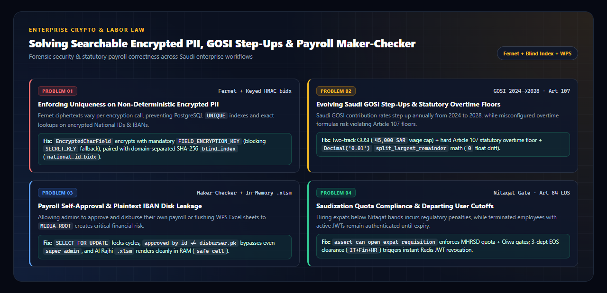
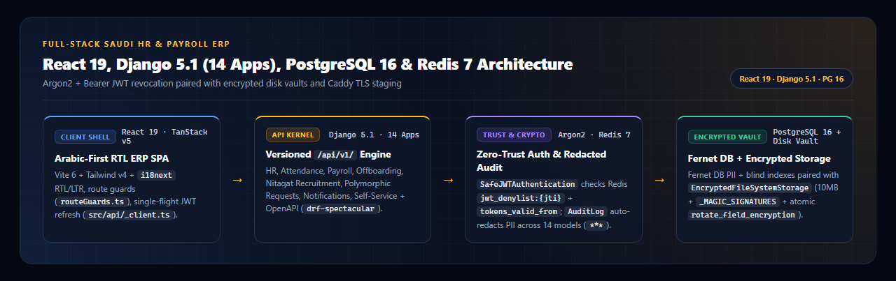
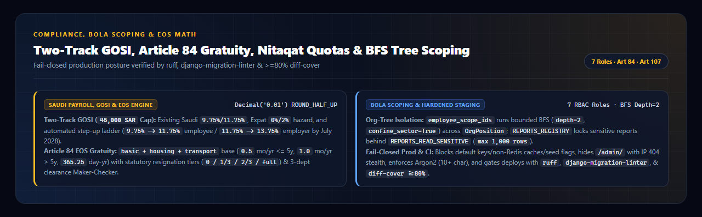
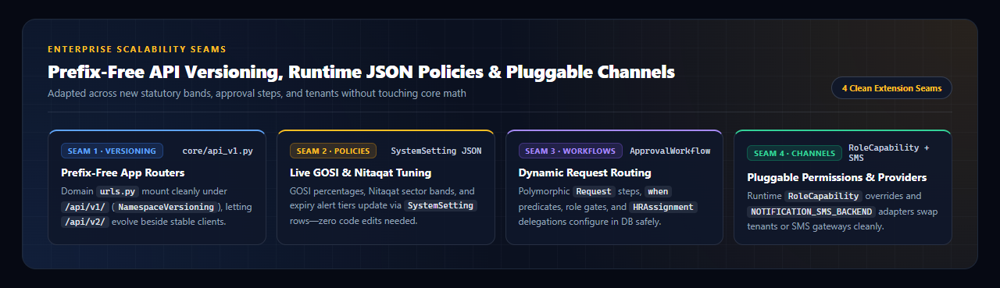

# Saaed (ساعد) — Enterprise Arabic-First Saudi HR & Payroll ERP

**Production Full-Stack HR, Attendance, Nitaqat Hiring Compliance, Article 84 EOS Gratuity & Encrypted Payroll ERP (`React 19`, `Django 5.1`, `PostgreSQL 16`, `Redis 7`, `Fernet PII + Blind Indexing`)**

[Problems Solved](#solving-saudi-labor-law--pii-encryption-problems) &nbsp;|&nbsp; [Architecture](#full-stack-enterprise-architecture) &nbsp;|&nbsp; [Payroll & Compliance](#payroll-nitaqat--bola-governance) &nbsp;|&nbsp; [Extensibility](#enterprise-extensibility-seams)

---

| System Dimension | Verified Implementation | Enterprise Guarantee |
| :--- | :--- | :--- |
| **Client Stack** | `React 19.0.0`, `TS 5.6.3`, `Vite 6.0`, `TanStack Router/Query v5` | Arabic-first `i18next` RTL UI + `beforeLoad` guards + single-flight JWT refresh |
| **Server Stack** | `Python 3.12`, `Django 5.1.15`, `DRF 3.17.1`, `drf-spectacular` | **14 modular Django apps** + `selfservice` mounted cleanly under `/api/v1/` |
| **Data & Revocation** | **`PostgreSQL 16`** + **`Redis 7`** | Row locks (`SELECT FOR UPDATE`), Redis `jwt_denylist:{jti}` & `tokens_valid_from` |
| **PII & Vault Crypto** | `cryptography.fernet 49.0.0` + `Argon2` | Mandatory `FIELD_ENCRYPTION_KEY`, keyed `blind_index`, `EncryptedFileSystemStorage` |
| **Saudi Statutory Math** | `Decimal('0.01')` `ROUND_HALF_UP` + `openpyxl 3.1.5` | Two-track GOSI (`45K SAR` cap), Art 107 OT floor, Art 84 EOS, in-memory Al Rajhi `.xlsm` |
| **CI Quality Gates** | `.github/workflows/ci.yml` | `ruff`, `pytest` on PG 16, `django-migration-linter 6.0.0`, **`diff-cover >=80%`** |

---

## Solving Saudi Labor Law & PII Encryption Problems

Building an HR and Payroll ERP for Saudi enterprises exposes four sharp intersections between cryptography, statutory compliance, and access isolation: non-deterministic ciphertext breaks relational uniqueness checks, evolving `2024 -> 2028` GOSI brackets must never drift under floating-point arithmetic, self-approval during payroll disbursement causes severe fraud exposure, and plaintext WPS sheets written to `MEDIA_ROOT` leak sensitive IBANs onto shared volumes.

  

1. **Searchable Encrypted PII Without Weakening Ciphertext (`common/encryption.py`):** `EncryptedCharField` applies non-deterministic `Fernet` (AES-128-CBC + HMAC) across `EmployeePersonal.{phone,national_id,address}` and `BankInfo.iban` using a mandatory isolated `FIELD_ENCRYPTION_KEY` (`common.config_validation` forbids fallback to Django's `SECRET_KEY`). To enforce `UNIQUE` constraints on encrypted IDs without storing plaintext or deterministic encryption, Saaed persists domain-separated keyed HMAC-SHA256 tokens (`national_id_bidx` via `b"blind-index:"`). An atomic `rotate_field_encryption` management command re-encrypts DB columns, disk vaults (`EncryptedFileSystemStorage` with magic-byte checks & 10MB caps), and blind indexes together.
2. **Exact Saudi Payroll & Article 107 Overtime Protection (`payroll/services/engine.py`):** Computes all financial ledger figures with `Decimal('0.01')` `ROUND_HALF_UP` and `split_largest_remainder`, implements Two-Track GOSI (`45,000 SAR` wage cap, phased annual step-ups from `2024-07-03` through `2028-07-01`, `0%/2%` expat occupational hazard), and enforces an unbypassable **Article 107 statutory floor** inside `compute_overtime_pay()`.
3. **Maker-Checker Payroll & In-Memory Al Rajhi `.xlsm` (`build_wps_csv`):** Acquires PostgreSQL `SELECT FOR UPDATE` locks over cycles (`draft -> approved -> paid`), compares `cycle.approved_by_id != disburser.pk` directly (intentionally bypassing `super_admin` wildcard permissions), and renders Al Rajhi `.xlsm` / WPS CSV streams solely in RAM with `common.exports.safe_cell` formula-injection sanitization—never writing IBANs to disk.

---

## Full-Stack Enterprise Architecture

  

### Fail-Closed Security & Zero-Leak Production Posture

- **Immediate Revocation & Constant-Time Login:** `UsernameOrEmailOrEmployeeIdBackend` executes constant-time dummy hashes against unknown users (`Argon2PasswordHasher`, 10-character minimum). `SafeJWTAuthentication` validates short-lived Bearer JWTs (`15m` access / `7d` rotating refresh) against Redis `jwt_denylist:{jti}` and per-user `tokens_valid_from`, severing offboarded employee sessions immediately on termination.
- **Redacted 14-Model Audit Trail (`AuditMiddleware`):** Logs mutations into `AuditLog` and `ActivityLog` while automatically redacting `EncryptedCharField`, `*_bidx`, and sensitive keys to `"***"`. `prod.py` fails closed at startup if default keys, non-Redis caches (`LocMemCache`), or seed flags are detected, and hides `/admin/` behind `AdminIPRestrictionMiddleware` (`404` stealth).

---

## Payroll, Nitaqat & BOLA Governance

  

- **MHRSD Nitaqat Weighted Hiring Gate (`hr/services/saudization.py`, `recruitment/services/nitaqat_gate.py`):** Evaluates salary-weighted Saudization credits (`>=4,000 SAR: 1.0`, `3,000–<4,000 SAR: 0.5`, Qiwa contract gate, `4x` disability weight capped at `10%`), blocking new expatriate requisitions via `assert_can_open_expat_requisition` whenever company headcount falls below `RECRUITMENT_SAUDIZATION_FLOOR` and bounding candidate offers strictly within `[salary_min, salary_max]`.
- **Article 84 End-of-Service & 3-Department Clearance (`offboarding/services/clearance.py`):** Calculates statutory severance across `basic + housing + transport` (`0.5` mo/yr first 5 years, `1.0` mo/yr beyond, resignation tiers `<2y: 0`, `2–5y: 1/3`, `5–10y: 2/3`, `>=10y: 1.0`), requires row-locked approval across **IT, Finance, and HR**, enforces an independent Maker-Checker settler distinct from all three department signers, deactivates employee status, and revokes live JWTs.
- **Bounded Org-Tree BOLA Isolation (`common/scoping.py`, `reports_engine.py`):** Isolates manager views across `OrgPosition` hierarchies using bounded BFS (`DEFAULT_MANAGER_SCOPE_MAX_DEPTH = 2`, `confine_sector = True`), locks sensitive exports behind `REPORTS_READ_SENSITIVE`, derives cache keys strictly server-side (`REPORTS_MAX_ROWS = 1,000`), and blocks self-approval in polymorphic `ApprovalWorkflow` chains.

---

## Enterprise Extensibility Seams

  

1. **Frozen Versioned Routers (`core/api_v1.py`):** Prefix-free domain `urls.py` attach under `NamespaceVersioning` (`/api/v1/`), enabling `/api/v2/` endpoints cleanly without breaking ERP web clients.
2. **Runtime Statutory Policy Overrides (`SystemSetting`):** Updating GOSI brackets, Nitaqat sector thresholds, or expiry alert windows takes one database configuration change without modifying core calculation code.
3. **Config-Driven Workflows & Roles (`ApprovalWorkflow`, `RoleCapability`, `HRAssignment`):** Approval sequences, conditional `when` steps, role permissions, and temporary manager delegations configure dynamically.
4. **Swappable Notification Channels (`NOTIFICATION_SMS_BACKEND`):** SMS/OTP dispatch abstracts behind a narrow provider interface alongside `Caddy` TLS staging & Docker Compose deployments.

---

> [!NOTE]
> Proprietary Saaed ERP source code and client database schemas are kept private under NDA; this showcase preserves the verified engineering architecture and security controls only.

[Portfolio](https://abdulqader-alshihabi.github.io/) &nbsp;|&nbsp; Built by **Abdulqader Alshihabi**

